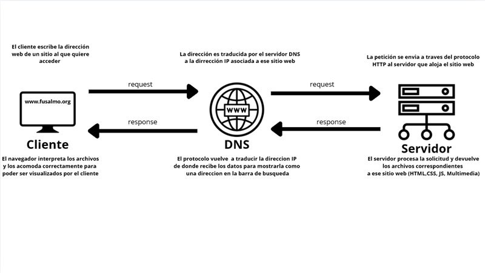

# bitacora-fullstack
Bitacora tecnica del curso desarrollador web fullstack

# 📓 Bitácora Fullstack

> Registro diario de mi aprendizaje en el curso de desarrollo web fullstack.

## 👤 Datos del estudiante

- **Nombre:** Carlos Eduardo Olano Mendez
- **Curso:** Desarrollador web fullstack / bootcamp
- **Fecha de inicio:** 13 de noviembre de 2026
- **GitHub:** [@CrlsMenz](https://github.com/CrlsMenz)
- **Correo:** carlos.ed4work@gmail.com

## 🎯 Objetivo del repositorio

Este repositorio funciona como mi **bitácora de aprendizaje**. Aquí documento
lo que veo en cada clase, los ejercicios que realizo, los errores que
encuentro y las cosas que aprendo, para poder repasar mi progreso a lo largo
del curso y mostrar mi evolución como desarrollador web.

## 🛠️ Tecnologías que aprenderé

- HTML
- CSS
- JavaScript
- Git y GitHub
- React

## 📁 Estructura del repositorio

```
bitacora-fullstack/
├── Main/
    ├── main.html
├── README.md
├── Sesion_1.txt
├── esquema-cliente-servidor.png
└── ...
```

## 📅 Bitácora por día

### Día 1 — 13/11/2026

**Temas vistos:**
- Presentación del curso
- Introducción al desarrollo web
- Fundamentos de la web

**Lo que aprendí:**
- Como funciona la web
- ¿Donde vive un sitio web?
- Preparar el entrono de trabajo
- La IA como asistente


**Esquema Cliente-Servidor:**
- 

### Dominio, hosting y servidor

### 🌐 Dominio vs Hosting vs Servidor

| Criterio | Dominio | Hosting | Servidor |
|---|---|---|---|
| **¿Qué es?** | Es el nombre único que identifica a un sitio web en internet (la "dirección" que escribes en el navegador). Se traduce a una dirección IP mediante el sistema DNS. | Es el servicio que alquila espacio en un servidor para almacenar los archivos de un sitio web (HTML, CSS, imágenes, bases de datos) y mantenerlos accesibles en línea. | Es una computadora potente, encendida las 24 horas, que almacena información y responde a las solicitudes de los usuarios que visitan un sitio o usan una aplicación. |
| **¿Para qué sirve?** | Para que las personas encuentren y recuerden fácilmente tu sitio sin tener que memorizar una dirección IP numérica. | Para que tu sitio esté publicado y disponible en internet todo el tiempo, sin necesidad de tener tu propia infraestructura. | Para procesar peticiones, ejecutar aplicaciones y enviar los archivos o datos necesarios al navegador del usuario. |
| **¿Tiene costo? ¿Cuánto aprox.?** | Sí. Se paga una renovación anual de aprox. **USD 10 a 20** (según la extensión: .com, .net, .org, etc.). | Sí, aunque existen opciones gratuitas con límites. Planes compartidos desde aprox. **USD 3 a 15 al mes**. | Depende del tipo. Un VPS cuesta aprox. **USD 5 a 40 al mes**; un servidor dedicado, desde **USD 80 al mes** en adelante. |
| **Ejemplo real** | `google.com`, `mipagina.com` (registrado en GoDaddy o Namecheap). | Hostinger, Bluehost, SiteGround; gratuitos para proyectos: GitHub Pages, Netlify, Vercel. | Servidores en la nube como AWS EC2, DigitalOcean o Google Cloud. |

> **💡 Analogía para recordarlo:** el **dominio** es la dirección de una casa, el **hosting** es el terreno que alquilas para construirla, y el **servidor** es la construcción donde realmente se guarda todo lo que hay dentro.


## 📝 Notas finales

Este repositorio seguirá creciendo durante todo el curso.